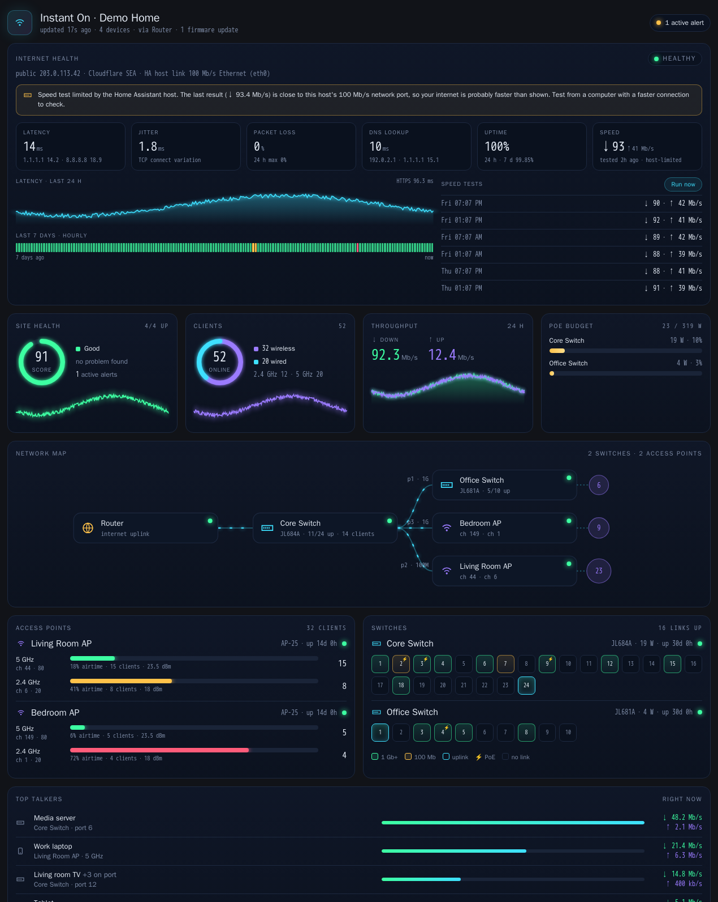

# HPE Instant On for Home Assistant

[](https://hacs.xyz/docs/faq/custom_repositories)
[](https://github.com/grahamfairbank/ha-instant-on/actions/workflows/validate.yml)


An **unofficial, read-only** Home Assistant integration for **HPE Aruba Networking Instant On** access points and switches.
It polls the same cloud API the Instant On web portal uses, so you get presence detection for every client on your network, plus
the online status of each AP and switch and the health of each site.



> [!WARNING]
> This integration uses an **undocumented** API that HPE does not support. It can break without notice.
> It is not affiliated with or endorsed by HPE.

---

## Contents

- [Features](#features)
- [Requirements](#requirements)
- [Step 1: create a dedicated account](#step-1-create-a-dedicated-account)
- [Step 2: install](#step-2-install)
- [Step 3: configure](#step-3-configure)
- [Step 4: open the Network view](#step-4-open-the-network-view)
- [Updating](#updating)
- [Dashboard card](#dashboard-card)
- [Internet health](#internet-health)
- [Client names](#client-names)
- [Entities](#entities)
- [Example automations](#example-automations)
- [Troubleshooting](#troubleshooting)
- [FAQ](#faq)
- [Limitations](#limitations)
- [Documentation](#documentation)
- [Credits and license](#credits-and-license)

## Features

- **Useful names for every client**, even ones Instant On only knows by MAC address: vendor, device type, and names from mDNS, DHCP, DNS and NetBIOS
- **Presence detection** for every wired and wireless client (`device_tracker`), with the AP or switch port it's connected to
- **Online/offline sensor** for every AP and switch, with uptime, health, uplink and firmware-currency attributes
- **Per-site sensors**: total, wireless and wired client counts, network device count, active alerts, health score
- Set up entirely in the UI, with site selection, re-authentication and options (poll interval, client tracking on/off)
- **Internet health** like a network monitor: latency, jitter, packet loss, DNS and HTTPS checks every 30 s, uptime, a 7-day status strip and scheduled speed tests, with a warning when the Home Assistant host's own network port limits the result
- A **Network** sidebar view, added automatically, and a built-in **mission-control dashboard card** with a live network map, health and client rings, 24 h throughput, PoE budget, AP radio use, switch port grids and top talkers
- Downloadable **diagnostics** with personal data redacted
- Supports multiple sites per account and multiple accounts

## Requirements

| | |
|---|---|
| Home Assistant | 2024.11 or later |
| Instant On | Any site managed in the Instant On cloud portal (APs and/or switches) |
| Account | A dedicated Instant On account with **MFA off** and **view-only** access ([why](#step-1-create-a-dedicated-account)) |
| Network | Outbound HTTPS from Home Assistant to `portal.instant-on.hpe.com` and `sso.arubainstanton.com` |

## Step 1: create a dedicated account

The API sign-in uses an email and password and **cannot answer an MFA prompt**. Don't turn off MFA on your admin account. Instead:

1. In the Instant On portal or app, open **Site → Administration → Invite** (wording varies by version) and invite a new email address
   (for example `you+homeassistant@example.com`) with the **view-only** role.
2. Accept the invitation and set a strong, unique password.
3. Make sure MFA is **off** for this new account. To check, sign in at <https://portal.instant-on.hpe.com>: you should not be asked for a code.

View-only access is enough for everything this integration does.

## Step 2: install

### HACS (recommended)

1. In HACS, open the three-dot menu → **Custom repositories**.
2. Add `https://github.com/grahamfairbank/ha-instant-on` with category **Integration**.
3. Search for **HPE Instant On**, then click **Download**.
4. Restart Home Assistant.

### Manual

1. Copy `custom_components/instant_on` from this repository into `/config/custom_components/` on your Home Assistant host.
2. Restart Home Assistant.

## Step 3: configure

1. Go to **Settings → Devices & services → Add integration** and search for **HPE Instant On**.
2. Enter the dedicated account's email and password.
3. Choose which sites to include. All sites are selected by default.

### Options

Open **Configure** on the integration card to change:

| Option | Default | Notes |
|---|---|---|
| Polling interval | 60 s | 30 to 3600 s. Lower values detect presence sooner and send more requests to HPE. |
| Create device trackers for clients | On | Turn off if you only want the site and device sensors. |
| Show the Network panel in the sidebar | On | Turn off if you'd rather put the card on your own dashboard (see below). |
| Monitor internet health | On | Checks from the Home Assistant host every 30 s. Turn off to remove the Internet entities and the card's Internet section. |
| Look up names for unnamed clients | On | See [Client names](#client-names). |
| Scan the local network to find wired clients' IP addresses | Off | Helps name wired devices. See [Client names](#client-names). |
| Run a speed test every (hours) | 6 | 0 turns scheduled tests off (you can still press **Run speed test**). Each test uses about 33 MB. |

### Enable the trackers you care about

A site can have hundreds of clients, so **client trackers are created disabled**. The exception: Home Assistant enables a tracker on its own when its MAC
matches a device another integration already knows (Sonos speakers, for example). To enable them, go to
**Settings → Entities**, search for `device_tracker.` and filter by the integration, select the clients you want (phones, for example),
then click **Enable selected**.

## Step 4: open the Network view

Once the integration is set up, a **Network** entry (icon: network diagram) appears in the sidebar. It shows the dashboard card full-screen,
and every Home Assistant user can see it. You don't need to create a dashboard.

- **Don't see it?** Refresh the browser (Ctrl+Shift+R). On the companion app, go to **Settings → Companion app → Debugging → Reset frontend cache**.
- **Don't want it?** Integration card → **Configure** → turn off **Show the Network panel in the sidebar**. It disappears straight away.

### Or: put the card on your own dashboard

Use this if you've hidden the panel, want the card next to other cards, or want it on a wall tablet's dashboard.

1. **Settings → Dashboards → Add dashboard → New dashboard from scratch.** Give it a title and an icon (for example `mdi:lan`), leave
   **Show in sidebar** on, and click **Create**. (To use an existing dashboard instead, skip this step.)
2. Open the dashboard and click the **pencil** (edit) icon at the top right.
3. For a full-screen card, click the pencil next to the view's name, set **View type** to **Panel (single card)**, and save.
   In a **Sections** view, make the card full width instead.
4. Click **Add card** → scroll to **Manual** (or search for "Instant On") → paste the YAML below → **Save**.
5. Click **Done**.

## Updating

New versions are published as [GitHub releases](https://github.com/grahamfairbank/ha-instant-on/releases). Read the
[changelog](CHANGELOG.md) before updating; it lists anything you need to do.

### If you installed with HACS

1. HACS checks for updates on its own. When there's a new version, **HPE Instant On** appears under **Settings → Updates**
   (and in HACS with an **Update** badge). To check straight away: HACS → three-dot menu → **Reload data** (or open the integration and
   choose **Update information**).
2. Click **Update** (in Settings → Updates, or HACS → HPE Instant On → **Download**). Pick the latest version if asked.
3. **Restart Home Assistant:** Settings → System → top-right power menu → **Restart Home Assistant**. Home Assistant only loads the new
   code after a restart. A repair notice may remind you.
4. **Refresh your browser** (Ctrl+Shift+R, or Cmd+Shift+R on a Mac). On the companion app: **Settings → Companion app → Debugging → Reset frontend cache**.
   Without this, the page can keep showing the old card even though the new version is installed.

### If you installed manually

1. Download the release's source code (or `git pull`) and copy its `custom_components/instant_on` folder over
   `/config/custom_components/instant_on`, replacing every file. Delete the old folder first if files were removed in the new version.
2. Restart Home Assistant and refresh your browser, as in steps 3 and 4 above.

To switch from a manual install to HACS (so you get update notices), install the same version through HACS, which replaces the folder, then
restart. Your settings and entities are kept.

### Which version am I running?

- **HACS** shows the installed version on the integration's HACS page.
- The card prints its version in the browser console (`INSTANT-ON-CARD 0.4.0`). If that's older than the version you installed, refresh the
  browser as above.

Settings, entities and history are kept across updates. Nothing is reset unless the changelog says so.

## Dashboard card

The integration ships its own card, so there's nothing extra to install. Card YAML:

```yaml
type: custom:instant-on-card
# site: Home             # optional: site name or id when the account has several sites
# sections: [header, kpis, map, aps, switches, talkers]   # optional: choose and order sections
```

| Section | Shows |
|---|---|
| `internet` | Internet health: status, latency, jitter, packet loss, DNS, uptime (24 h / 7 d), speed test results with a **Run now** button, 24 h latency chart and a 7-day hourly status strip. See [Internet health](#internet-health). |
| `header` | Site name, last update, overall status (offline devices or alerts) |
| `kpis` | Site health ring, clients ring (wireless/wired, by band), throughput with 24 h history, PoE budget per switch |
| `map` | Live network map, from the gateway through switches to APs, with link speeds and client counts. Swipe sideways on phones. |
| `aps` | Each AP's radios: band, channel, width, airtime utilization, clients, transmit power |
| `switches` | Port grids: link speed, uplinks, PoE (⚡). Hover a port for its peer, power and throughput. |
| `clients` | Every client with its best name (and where the name came from), vendor, device type, AP or switch port, and IP. Filters: online, wireless, wired, named by lookup, recently seen. |
| `talkers` | The busiest clients right now. Clients behind the same switch port are grouped, because the API reports port traffic for each of them. |

The card uses a fixed dark "mission control" palette, whatever your Home Assistant theme. History sparklines fill in as Home Assistant records the sensors.

## Internet health

The integration checks the internet from the Home Assistant host every 30 seconds. This part doesn't depend on Instant On.

| Check | How |
|---|---|
| Latency, jitter, packet loss | 5 TCP connections each to 1.1.1.1 and 8.8.8.8 on port 443. Home Assistant can't usually send ICMP pings, so this is TCP connect time, which runs a few ms above ping. |
| DNS lookup | A query to the host's own resolver and to 1.1.1.1 |
| HTTPS response | A fresh HTTPS request to `www.google.com/generate_204` (DNS + TCP + TLS) |
| Status | **Healthy**, **Degraded** (latency over 80 ms, 10% or more loss, or HTTPS failing) or **Down** (nothing reachable) |
| Public IP, Cloudflare location | `1.1.1.1/cdn-cgi/trace`, every 10 minutes |
| Speed test | Cloudflare (`speed.cloudflare.com`): 4 parallel downloads (25 MB in total), then 4 parallel uploads (8 MB). First run 2 minutes after start-up, then on the schedule in Options. |

### Speed tests and the Home Assistant host's network port

A speed test can only measure as fast as the machine running it. Many Home Assistant hosts are slower than the internet connection:
older Raspberry Pis (3B and earlier) have a **100 Mb/s** Ethernet port, and some hosts are on Wi-Fi. The integration reads the host's
own link (interface, speed, and Ethernet, Wi-Fi or virtual) and the card says so:

- **Port 100 Mb/s or slower:** a note that results can't go above about that speed.
- **Result within 15% of the port speed:** "Speed test limited by the Home Assistant host". Your internet is probably faster than shown.
- **Wi-Fi:** results measure the Wi-Fi link as much as the internet.
- **Virtual machine:** the reported port speed is nominal; the physical host's port is the real limit.

The link is also a diagnostic sensor (**Host link speed**). If a result is host-limited, the download sensor has `limited_by_host_link: true`.


### Per site (device: *Instant On &lt;site name&gt;*)

| Entity | State | Attributes |
|---|---|---|
| `sensor.<site>_clients` | Connected clients | |
| `sensor.<site>_wireless_clients` | Connected wireless clients | |
| `sensor.<site>_wired_clients` | Connected wired clients | |
| `sensor.<site>_network_devices` | APs and switches in inventory | |
| `sensor.<site>_active_alerts` | Active alert count | `latest_alert`, info/minor/major counts |
| `sensor.<site>_health_score` | Site health score, 0 to 100 | `health`, `reason` |
| `sensor.<site>_download_throughput` / `_upload_throughput` | Total client throughput (Mb/s), counting each switch port once | |

### Per AP or switch (one device each, linked to the site)

| Entity | State | Attributes |
|---|---|---|
| `binary_sensor.<device name>` | `on` = connected (status `up`) | `deviceType`, `health`, `operationalState`, `uptimeInSeconds`, `numberOfSecondsSinceLastCommunication`, `uplinkDeviceName`, `isUpToDate`, `wiredClientsCount`, `inputPowerSource` |

| `sensor.<device>_clients` | Clients connected to this AP or switch | |
| `sensor.<ap>_channel_utilization` | Busiest radio's airtime use (%) | channel, width, utilization and clients per band |
| `sensor.<switch>_poe_power` | PoE power drawn (W) | `budget_w` |

### Internet (device: *Internet*, when internet health is on)

| Entity | State | Attributes |
|---|---|---|
| `sensor.internet_internet_status` | `healthy` / `degraded` / `down` | `outage_since`, `public_ip`, `cloudflare_location` |
| `binary_sensor.internet_internet` | `on` while the internet is reachable | |
| `sensor.internet_latency` / `_jitter` (ms) | Best of 1.1.1.1 and 8.8.8.8 | per-target latency |
| `sensor.internet_packet_loss` (%) | Worst of the two targets | |
| `sensor.internet_dns_lookup` / `_https_response` (ms) | | resolver used |
| `sensor.internet_download_speed` / `_upload_speed` (Mb/s) | Last speed test (kept across restarts) | `tested_at`, `limited_by_host_link`, `host_link_mbps` |
| `sensor.internet_host_link_speed` (Mb/s, diagnostic) | The Home Assistant host's network port | `interface`, `type` |
| `button.internet_run_speed_test` | Runs a speed test now | |

The device registry entry includes the model, SKU, serial number, firmware version and MAC address.

### Per client (disabled by default)

| Entity | State | Attributes |
|---|---|---|
| `device_tracker.<client name>` | `home` / `not_home` | `ip`, `host_name`, `mac`, `connection` (wired/wireless), `deviceName` (AP or switch), `switch_port`, `wirelessBand`, `wirelessNetworkName`, `wiredNetworkName`, `signalQuality`, `snrInDb`, `health`, `stateDurationInSeconds` |

You can assign these trackers to a **Person** for presence.

## Client names

Instant On often knows a client only by its MAC address, especially wired devices. The integration fills in the gaps, trying these
sources in order and using the first that gives a real name:

| # | Source | Example | Notes |
|---|---|---|---|
| 1 | Instant On | "Work laptop" | The name you or Instant On gave it |
| 2 | Home Assistant | "Kitchen speaker" | A name another integration (Sonos, Cast…) gave a device with the same MAC |
| 3 | mDNS | "Kitchen", "HP OfficeJet Pro 9010" | From Home Assistant's zeroconf cache. Matched by IP, or by the MAC that many devices put in their hostname (`Sonos-0011AA…`, `HPA1B2C3`). |
| 4 | DHCP | "media-server" | The hostname from Instant On or Home Assistant's DHCP watcher |
| 5 | Reverse DNS | "nas.home.lan" | Only if your router publishes names in DNS |
| 6 | NetBIOS | "DESKTOP-4F2K" | Windows and Samba machines |
| 7 | Vendor | "Sonos · 12:34:56" | From the MAC prefix, with the last 3 bytes so similar devices stay distinguishable |
| — | Private address | "Private address · 9a:bc:de" | Phones and laptops using a randomized Wi-Fi MAC have no vendor to look up |

Every client also gets a **vendor** and a **device type** (speaker, camera, printer, TV, console, computer, Apple, phone, IoT), used for
the card's icons and in the device tracker's attributes (`vendor`, `device_type`, `name_source`, and `mdns_name` / `dhcp_name` / … when found).

- **Privacy:** MAC addresses never leave your network. The vendor database (Wireshark's `manuf`, about 3 MB) is downloaded whole from
  wireshark.org once a month and looked up locally. mDNS, DNS and NetBIOS lookups only talk to devices and resolvers on your network.
- **IP addresses for wired clients:** Instant On doesn't report them, and DNS and NetBIOS lookups need one. The integration takes IPs from
  Home Assistant's DHCP watcher and the host's ARP table. If many wired clients still have no IP, turn on **Scan the local network…**: once an hour
  it sends one tiny packet to each address on the Home Assistant host's subnet (/24 or smaller), which fills the ARP table.
- **Timing:** names refresh in the background after each poll, and each client's network lookups at most every 6 hours. Results are cached across restarts.

## Example automations

<details>
<summary>Notify when an access point goes offline</summary>

```yaml
alias: Instant On - AP offline
triggers:
  - trigger: state
    entity_id: binary_sensor.upstairsap
    to: "off"
    for: "00:05:00"
actions:
  - action: notify.notify
    data:
      message: "Upstairs AP has been offline for 5 minutes"
```
</details>

<details>
<summary>Notify on new Instant On alerts</summary>

```yaml
alias: Instant On - new alert
triggers:
  - trigger: state
    entity_id: sensor.instant_on_home_active_alerts
conditions:
  - condition: template
    value_template: "{{ trigger.to_state.state | int(0) > trigger.from_state.state | int(0) }}"
actions:
  - action: notify.notify
    data:
      message: "Instant On has {{ trigger.to_state.state }} active alert(s)"
```
</details>

<details>
<summary>Turn off lights when everyone's phone leaves Wi-Fi</summary>

```yaml
alias: Everyone left
triggers:
  - trigger: state
    entity_id:
      - device_tracker.alex_phone
      - device_tracker.sam_phone
    to: not_home
    for: "00:10:00"
conditions:
  - condition: state
    entity_id:
      - device_tracker.alex_phone
      - device_tracker.sam_phone
    state: not_home
actions:
  - action: light.turn_off
    target:
      area_id: living_room
```
</details>

## Troubleshooting

| Symptom | Cause and fix |
|---|---|
| **"Login failed"** during setup | Wrong password, or MFA is still on for the account. Sign in at the portal and check you're not asked for a code. |
| **"This account has no sites"** | The account wasn't invited to a site, or the invitation wasn't accepted. |
| A **re-authenticate** notification appears | The password changed or the account was locked. Click **Reconfigure** and enter the new password. |
| All entities are **unavailable** | Your internet connection or the Instant On cloud is down, or the API changed. Check the logs. |
| A wired client has **no IP** | Expected: the API reports no IP for most wired clients. Presence uses the MAC address. |
| Phone flips to `not_home` while at home | The phone's Wi-Fi sleeps or it uses a private (random) MAC. Turn off private MAC for your home network on the phone. |
| No **Network** entry in the sidebar | Check **Show the Network panel in the sidebar** is on (integration card → **Configure**), then refresh the browser. The panel appears once the integration has loaded. |
| The card shows **"Configuration error"** or "Custom element doesn't exist" | The integration isn't loaded (check **Settings → Devices & services**), or the browser has an old copy of the card. Refresh the page with Ctrl+Shift+R (on the companion app: **Settings → Companion app → Debugging → Reset frontend cache**). |
| The card's charts say **"collecting history…"** | The sensors are new. The charts fill in as Home Assistant records data, which takes a few polls. They show up to 24 hours. |
| Speed test results look low | Check the **HA host link** line in the card's Internet section. A 100 Mb/s port, Wi-Fi or a busy Raspberry Pi caps the result. |
| Latency is a few ms higher than `ping` | Expected: the integration times TCP connections because Home Assistant usually can't send ICMP pings. |
| A client shows as "Sonos · 12:34:56" instead of a room name | No better source answered yet. mDNS needs Home Assistant's zeroconf (on by default) and the device on the same network as Home Assistant. Names fill in over a few polls. |
| A client in **Top talkers** says "+6 on port" | Several wired clients sit behind one switch port (for example behind an unmanaged switch or a Sonos system). The API reports the port's traffic for each of them, so the card shows them as one row. |
| Some **client trackers are already enabled** | Home Assistant enables a tracker automatically when its MAC matches a device it already knows from another integration (Sonos, for example). Everything else starts disabled. |
| A value looks wrong | Download diagnostics (integration card → three-dot menu → **Download diagnostics**) and open an issue with the file attached. |

### Debug logging

```yaml
# configuration.yaml
logger:
  default: warning
  logs:
    custom_components.instant_on: debug
```

## FAQ

**Does it talk to my devices locally?** No. Everything goes through HPE's cloud, the same as the Instant On app.

**Can it block clients, toggle SSIDs or power-cycle PoE ports?** Not yet. The integration is read-only by design, and a view-only account
can't make changes anyway. Write support would need the portal's change requests mapped out first. Contributions are welcome.

**How much traffic does it generate?** Each Instant On poll makes `1 + 2 × number of sites` small HTTPS requests. Internet health adds a few small connections every 30 s, and each speed test uses about 33 MB (about 130 MB a day at the default 6-hour schedule). The sign-in token lasts about 30 minutes,
so it signs in again (3 requests) roughly every 30 minutes.

**Where are my credentials stored?** In Home Assistant's config entry storage (`/config/.storage/core.config_entries`), unencrypted, like most
integrations. This is why the account should be dedicated, view-only and used for nothing else.

## Limitations

- Unofficial API: it may change or be blocked at any time (the old `wiredClientSummary` endpoint already returns 404).
- Cloud only: presence updates once per poll interval, and the integration doesn't work while the internet or the HPE cloud is down.
- MFA must be off on the integration's account.
- Alerts come from the site summary. The alert detail endpoint isn't used yet.

## Documentation

- [Architecture](docs/ARCHITECTURE.md): components, data flow, sign-in sequence, error handling
- [API notes](docs/API.md): endpoints and fields seen on a live site
- [Card preview tool](tools/card-preview/README.md): work on the card and the Network panel in a browser, without Home Assistant
- [Contributing](CONTRIBUTING.md) · [Security](SECURITY.md) · [Changelog](CHANGELOG.md)

## Credits and license

- The sign-in flow and endpoints were first documented by [blog.puddle.town/instant-on](https://blog.puddle.town/instant-on/).
- Released under the [MIT License](LICENSE).
- HPE, Aruba and Instant On are trademarks of Hewlett Packard Enterprise. This project is not affiliated with HPE.
