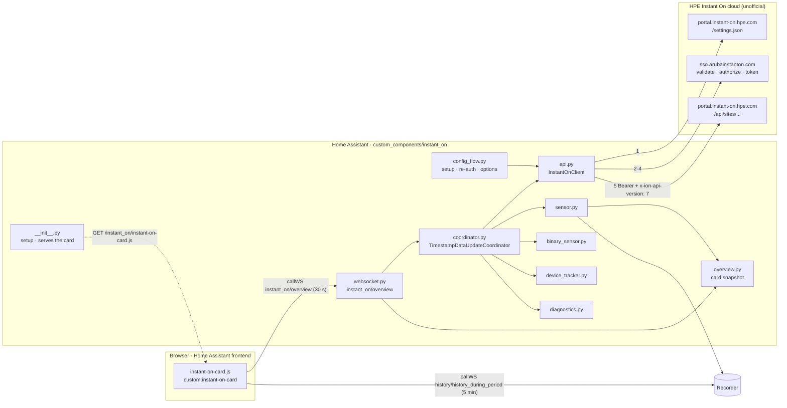
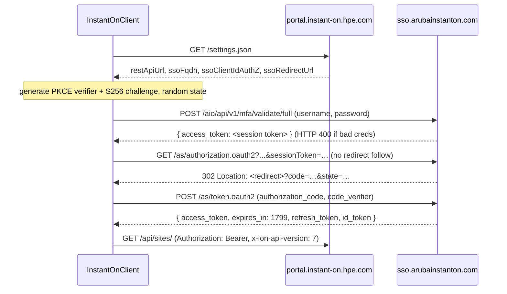

# Architecture

This document explains how the `instant_on` integration and its dashboard card fit together, for contributors and anyone reviewing the code.

## Overview



The integration follows the standard Home Assistant **hub + coordinator** pattern:

- **One config entry per Instant On account.** The entry stores the email, password and selected site IDs.
- **One coordinator per entry.** All entities read from it, so each poll is a single batch of API calls, however many entities exist.
- **Entities never call the API.** They only read from `coordinator.data`.
- **The card never calls the API either.** It reads a snapshot of the coordinator data over Home Assistant's websocket, plus the
  history Home Assistant has recorded for the integration's sensors.

## Files

| File | Responsibility |
|---|---|
| `api.py` | Async `aiohttp` client: discovery, PKCE sign-in, token cache, authenticated GETs. No Home Assistant imports, so it can be tested on its own. |
| `const.py` | Constants and small pure helpers (`client_mac`, `client_name`, `is_wireless`, `is_online`). |
| `coordinator.py` | Polls sites, then clients and inventory for each site in parallel. Converts API errors into `ConfigEntryAuthFailed` or `UpdateFailed`. A `TimestampDataUpdateCoordinator`, so the card can show when data was last fetched. Also holds `site_device_ids`. |
| `__init__.py` | `async_setup` registers the websocket command, serves the card file and adds it to every frontend page. `async_setup_entry` creates the client and coordinator, registers a device for each site, sets up the platforms, then adds or removes the Network sidebar panel. |
| `config_flow.py` | `user` step (credentials) → `sites` step (multi-select), `reauth_confirm`, and the options flow. |
| `entity.py` | `InstantOnEntity` base class and `DeviceInfo` builders for sites and network devices. |
| `inventory.py` | `complete_inventory()`: adds devices that the inventory's `metaData…siteDevices` lists but its `elements` omit, using switch-port and client data for uplink and radios. No Home Assistant imports. |
| `overview.py` | Pure function `build_site()` that turns raw API data into the compact snapshot the card draws, and `talkers()` / `site_throughput()`, which count each switch port once. No Home Assistant imports. |
| `websocket.py` | `instant_on/overview` command: builds a snapshot for every site of every loaded entry, adding the entity IDs the card needs for history. |
| `sensor.py` | Site sensors (`SiteSensor`) and per-device sensors (`DeviceSensor`), defined with entity descriptions and `value_fn`s. |
| `binary_sensor.py` | One connectivity sensor per inventory device. |
| `device_tracker.py` | One `ScannerEntity` per client MAC. New clients are added as they appear. Created disabled by default. |
| `internet.py` | `InternetCoordinator`: internet health probes every 30 s, the speed test and its schedule, and `host_link()` (the HA host's own NIC). |
| `button.py` | **Run speed test** button. |
| `names.py` | `ClientNamer`: resolves and caches names, vendor and device type per client MAC. See [Client names](#client-names). |
| `diagnostics.py` | Dumps the coordinator data with credentials and personal fields redacted. |
| `frontend/instant-on-card.js` | The dashboard card (`instant-on-card`) and the sidebar panel (`instant-on-panel`): dependency-free web components, no build step. |

## Authentication



- **Discovery first.** Hostnames and the OAuth client ID come from `settings.json` and are never hard-coded, so a portal migration
  (like the earlier move from `portal.arubainstanton.com`) keeps working.
- **Token lifetime.** Tokens are cached until `expires_in - 60 s`. The `refresh_token` is not used yet; signing in again costs 3 requests about
  every 30 minutes.
- **Concurrency.** An `asyncio.Lock` around the token check means requests running in parallel trigger only one sign-in.
- **401 handling.** On a 401, the token is marked expired and the request is retried once. A second 401 raises `InstantOnAuthError`.
- **Isolation.** The client has its own `ClientSession`, so SSO cookies never leak into Home Assistant's shared session.

## Polling and data model

Each update (default every 60 s, configurable from 30 to 3600 s):

```
GET /api/sites/                              -> filter to selected site IDs
for each site (sites in sequence; the two calls per site in parallel):
    GET /api/sites/{id}/clientSummary        -> SiteData.clients  (dict keyed by lower-case MAC)
    GET /api/sites/{id}/inventory            -> SiteData.inventory (plus devices only listed in metaData.siteDevices)
```

`coordinator.data` is `dict[site_id, SiteData]`, where `SiteData.site` is the raw site record. The site record already includes
`activeAlertsCount`, `activeAlertsCounters`, `latestActiveAlert`, `health` and `currentHealthScore`, so `/alerts` is not polled.
The inventory includes everything the card needs: radios, switch ports, PoE and uplinks.

### Rules from live data

| Rule | Why |
|---|---|
| Connected means `status == "up"` | `clientSummary` also lists recently seen clients with `status: "down"` |
| Wired or wireless comes from `clientType` | Falls back to `wirelessNetworkId` being set |
| Clients and devices are keyed by MAC | `id` equals the MAC for both clients and inventory devices |
| `ipAddress` may be `""` | Most wired clients report no IP |
| **Count throughput once per switch port** | A wired client reports the throughput of the port it's behind. When several clients share a port (an unmanaged switch, a Sonos system), they all report the same number. `overview.talkers()` groups wired clients by `(deviceId, portNumber)` from `connectedToPorts`. Without this, site throughput read 262 Mb/s instead of about 100 Mb/s on the test site. |
| Gateway name comes from the root switch | The router usually isn't an Instant On device; the root switch's `uplinkDeviceName` names it (for example a MikroTik router). |

## Internet health

A second coordinator, `InternetCoordinator` (`internet.py`), runs when **Monitor internet health** is on. It's stored on
`coordinator.internet` and doesn't depend on Instant On.

Every 30 s, in parallel:

| Probe | Method | Notes |
|---|---|---|
| Latency, jitter, loss | 5 × TCP connect to `1.1.1.1:443` and `8.8.8.8:443` (2 s timeout each) | Home Assistant usually has no raw-socket permission for ICMP. Latency and jitter use the faster target; loss uses the worse one. |
| DNS | Raw UDP `A` query for `www.google.com` to the first `nameserver` in `/etc/resolv.conf`, and to `1.1.1.1` | Run in the executor (blocking sockets) |
| HTTPS | `GET https://www.google.com/generate_204` with `Connection: close` | Includes TCP and TLS setup each time |
| Host link | `/proc/net/route` (default route interface), then `/sys/class/net/<if>/speed`, `/wireless`, `/device/driver` | On HA OS the core container shares the host's network namespace, so this is the real NIC. Drivers `virtio_net`, `vmxnet3`, `hv_netvsc` and the like mean a VM. |
| Trace | `https://1.1.1.1/cdn-cgi/trace` | Every 10 min while up: public IP and Cloudflare location |

**Status:** `down` when both TCP targets and HTTPS fail; `degraded` at 10% or more loss, over 80 ms latency, or HTTPS failing; otherwise `healthy`.
`outage_since` is set at the first `down` sample.

**Speed test** (`async_run_speedtest`): a `bytes=0` request for latency, then 4 parallel downloads of `__down?bytes=` (25 MB total), then 4 parallel
uploads to `__up` (8 MB total), all on the coordinator's own session. A lock stops overlapping runs, and a 5-minute cooldown applies to scheduled
runs (the button bypasses it). It runs 2 minutes after setup, then every N hours (`async_track_time_interval`), or never when N = 0. The
result is marked `capped` when the faster direction reaches 85% or more of the host's link speed. Download and upload sensors are
`RestoreSensor`s, so the last result survives restarts.

**In the card:** the `instant_on/overview` payload has an `internet` object (the latest probe data, `link`, `speed`, `speed_running` and
`entities`). The card reads 24 h of latency and loss history and 7 days of status, download and upload history from the recorder. Uptime is the
share of recorded time not `down`; the strip shows the worst state in each hour. **Run now** presses the button entity, then refreshes after
15, 35 and 60 s.

## Client names

`ClientNamer` (`names.py`) runs when **Look up names for unnamed clients** is on. It's stored on `coordinator.namer`. After each successful poll,
the coordinator calls `namer.schedule(clients)`, which starts a background refresh unless one is already running. When the refresh
finishes, it saves the cache and calls `coordinator.async_update_listeners()`, so entities and the card pick up new names without waiting
for the next poll.

Per refresh:

1. **Optional subnet sweep** (option off by default, at most hourly): one empty UDP datagram to port 9 on every host of the HA host's
   directly connected IPv4 networks of /24 or smaller (Docker and HA-internal ranges are skipped), so the kernel ARPs them.
2. **Bulk sources**, gathered in parallel:
   - `/proc/net/arp`: MAC → IP
   - `dhcp.async_get_address_data_internal()`: MAC → IP and hostname. This is an internal Home Assistant API, so it's wrapped and optional.
   - Home Assistant's zeroconf cache: A records give host → IP, and SRV records give host → service instances (the friendly name is the part
     after `@`, as Sonos uses). Indexed by IP, by a 12-hex-digit MAC found in the hostname, and by the last 6 hex digits when only one host has them.
   - the device registry: names of other integrations' devices with a MAC connection, ignoring bare MACs and this integration's own devices.
3. **Per client:** vendor from the OUI table (36-, 28- and 24-bit prefixes), whether the MAC is randomized (locally administered bit), IP
   (Instant On, then DHCP, then ARP, then mDNS), then, at most every 6 h and 8 at a time, reverse DNS and a NetBIOS node-status query
   (UDP 137), each with a 2 s timeout.

`label(client)` picks the display name: Instant On name, then HA device name, mDNS, DHCP hostname, reverse DNS, NetBIOS, `"<vendor> · <last 3 bytes>"`,
`"Private address · …"`, and finally the MAC. MAC-like strings are never accepted as names. Device type comes from mDNS service types first
(`_sonos._tcp`, `_ipp._tcp`, …), then vendor keywords.

**Vendor database:** `https://www.wireshark.org/download/automated/data/manuf.gz`, saved as `.storage/instant_on.manuf.gz` and re-downloaded
when it's more than 30 days old. If the download fails, the cached copy is used. **Cache:** `.storage/instant_on.client_names`.

`overview.build_site(..., label)` uses the labels for Top talkers and builds `client_list` (every client, online first) for the card's
Clients section.

## Entities

| Entity | Unique ID | Source |
|---|---|---|
| Site sensors: clients, wireless, wired, network devices, active alerts, health score | `{site_id}_{key}` | Site record and client list |
| Site throughput: download, upload (Mb/s) | `{site_id}_throughput_down` / `_up` | `site_throughput()`, one entry per wireless client and per switch port |
| Device clients | `dev_{mac}_clients` | Clients whose `deviceId` is this AP or switch |
| AP channel utilization (%) | `dev_{mac}_channel_utilization` | Highest `radios[].utilizationPercent`; every radio's details are attributes |
| Switch PoE power (W) | `dev_{mac}_poe_power` | `poePseConsumedPowerInWatts`; budget as an attribute |
| Device connectivity | `dev_{mac}_online` | `status == "up"` |
| Client tracker | `client_{mac}` | `clientSummary` entry |
| Internet sensors, connectivity, speed test button | `internet_{entry_id}_{key}` | `InternetCoordinator`; all on one *Internet* service device |

### Device registry

- Each **site** is a device. `async_setup_entry` registers these *before* setting up the platforms and stores their registry IDs in
  `coordinator.site_device_ids`.
- Each **AP or switch** is a device linked to its site with `via_device_id`, plus a MAC connection so it can merge with other integrations
  that know the same MAC. (`via_device` with an identifier tuple is deprecated and stops working in Home Assistant 2027.8.)
- **Trackers** create no devices of their own. Home Assistant enables a tracker automatically when its MAC matches a device that's already registered.

## Dashboard card

### How it's delivered

The card ships inside the integration, so users don't need HACS frontend resources or any manual setup:

1. `async_setup` serves `frontend/instant-on-card.js` at `/instant_on/instant-on-card.js` (`StaticPathConfig`, cache headers on).
2. It calls `frontend.add_extra_js_url()` with a `?v=<file mtime>` query, so every frontend page loads the card, and browsers fetch
   a fresh copy after an update and restart.

3. If any loaded entry has **Show the Network panel in the sidebar** on (the default), `panel_custom.async_register_panel()` adds a
   **Network** sidebar panel at `/instant-on`. The panel is the `instant-on-panel` element from the same file: a Home Assistant-style
   top bar (with the sidebar menu button on phones) above a full-width `instant-on-card`. Panels are global, not per entry, so the panel is
   registered once, and removed (`frontend.async_remove_panel`) when the last entry that wants it unloads or turns the option off.
   Changing the option reloads the entry, which re-runs this check.

**Registry quirk.** Extra module URLs load before the Home Assistant app installs its own (scoped) custom element registry.
A card that calls `customElements.define()` straight away lands in the browser's original registry. The element still upgrades, but Lovelace's
`customElements.get()` can't see it and shows *Configuration error*. The file therefore polls (every 100 ms, for up to 30 s) until
`home-assistant` or `hui-view` is defined, and only then registers both elements.

### Data flow

| Call | When | Returns |
|---|---|---|
| `instant_on/overview` | On first render, then every 30 s | `{"sites": [snapshot, ...]}` (see below) |
| `history/history_during_period` | On first render, then at most every 5 min | 24 h history for the site's clients, throughput and health-score sensors (minimal response, no attributes) |

A snapshot (`overview.build_site()`) contains: `id`, `name`, `health`, `health_reason`, `score`, `alerts{total, major, minor, info, latest}`,
`gateway`, `clients{total, wireless, wired, bands}`, `throughput{down, up}` (bit/s), `devices[]` (with `radios[]`, `ports[]`, `poe`, `uplink`,
`clients`), `top_clients[]` (one row per wireless client or switch port, with `others` = clients sharing the port), `entities` (entity
IDs for history) and `updated` (time of the last successful poll).

### Rendering

- One plain `HTMLElement` with a shadow root and no framework or build step. Each refresh re-renders the whole card; it's small enough.
- Sections: `header`, `kpis`, `map`, `aps`, `switches`, `talkers`, selected and ordered by the `sections` option. When `aps` and `switches`
  are next to each other, they share a row.
- The **network map** is a tidy-tree layout in SVG: leaves take consecutive rows, and parents centre on their children. Links are Bézier curves with
  an animated dash. Leaf devices get a client bubble; parent devices show their client count in the subtitle, so nothing overlaps a link.
  On narrow screens, the map scrolls sideways instead of shrinking.
- The layout responds to the card's own width (container queries), not the window's: four KPI tiles, then two, then one.
- The palette is fixed (the "mission control" look) and doesn't follow the Home Assistant theme.

## Error handling

| Failure | Result |
|---|---|
| Bad credentials or MFA on (sign-in) | `InstantOnAuthError` → `ConfigEntryAuthFailed` → Home Assistant starts the re-auth flow |
| Network error, 5xx, unexpected 4xx | `InstantOnError` / `OSError` / `TimeoutError` → `UpdateFailed` → entities become unavailable, retried next interval |
| Fails during the first refresh | `ConfigEntryNotReady`: Home Assistant retries setup with backoff |
| Client disappears from the list | Tracker → `not_home` (stays available) |
| Card can't reach `instant_on/overview` | Before any data has loaded, the card shows the error message. After that it keeps showing the last data (the header's "updated … ago" shows its age). Either way it retries every 30 s. |
| History unavailable | Charts show "collecting history…" and the rest of the card still renders |

## Security

- The account's credentials are stored in the config entry, like most integrations. Hence the requirement for a dedicated, view-only account.
- Diagnostics redact `username`, `password`, `macAddress`, `mac`, `ipAddress`, `serialNumber`, `hostName` and `name`.
- The integration only makes GET requests to the REST API, so it can't change your network.
- The websocket command requires an authenticated Home Assistant user and returns only data that user could already see through the entities.

## Possible future work

- Use `refresh_token` instead of signing in again in full
- Pick up new network devices without a reload
- A visual card editor (`getConfigElement`)
- Write actions (block a client, toggle an SSID, power-cycle a PoE port), which need an admin account and request mapping
- Unit tests with recorded fixtures (`pytest-homeassistant-custom-component`)
